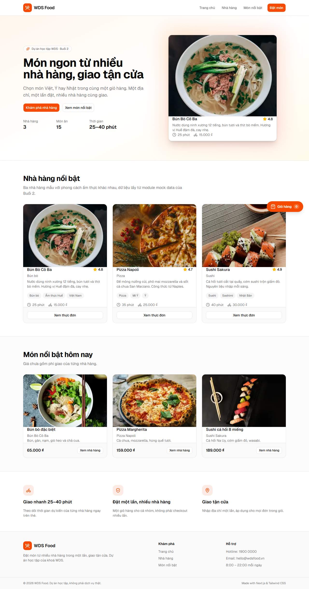
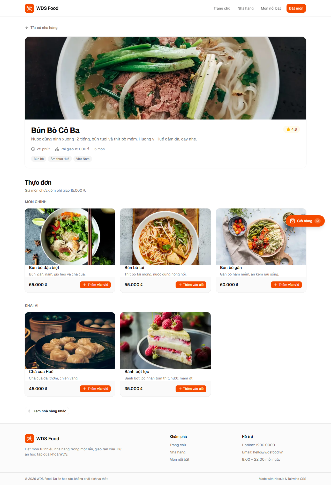
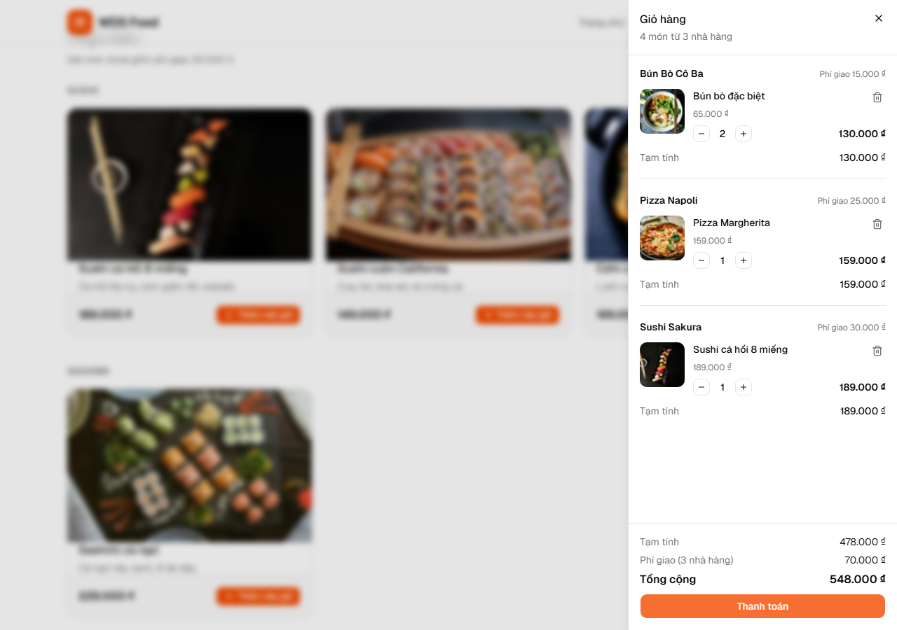
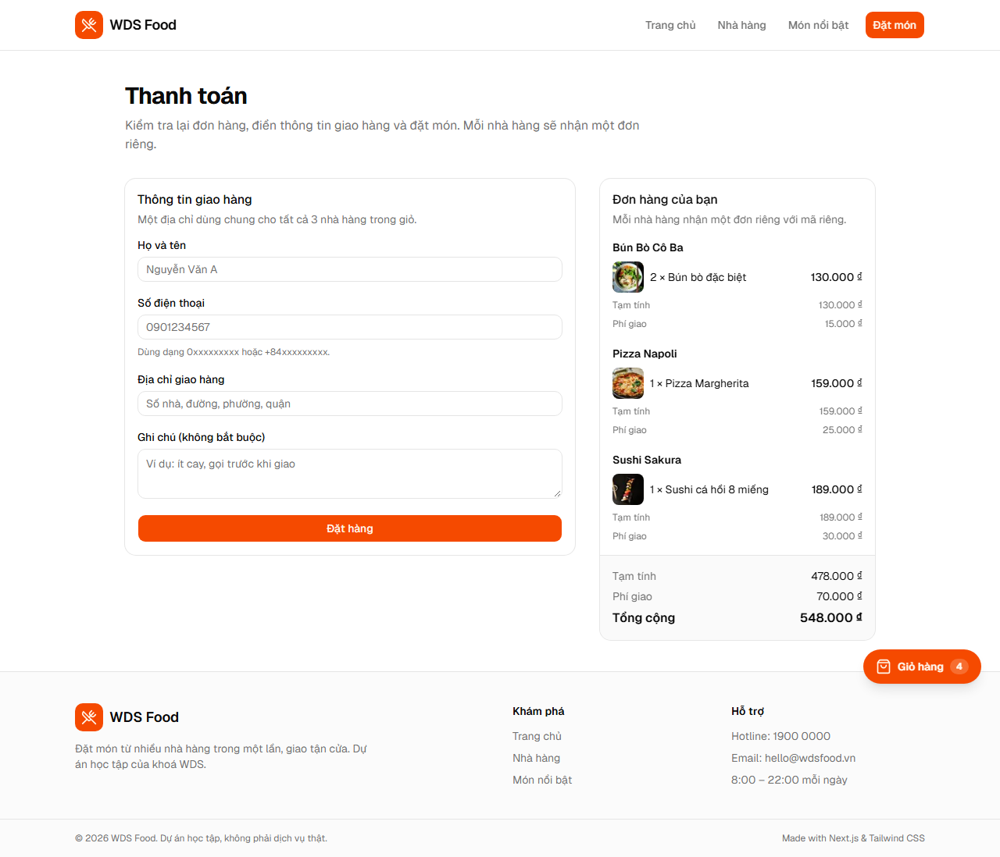
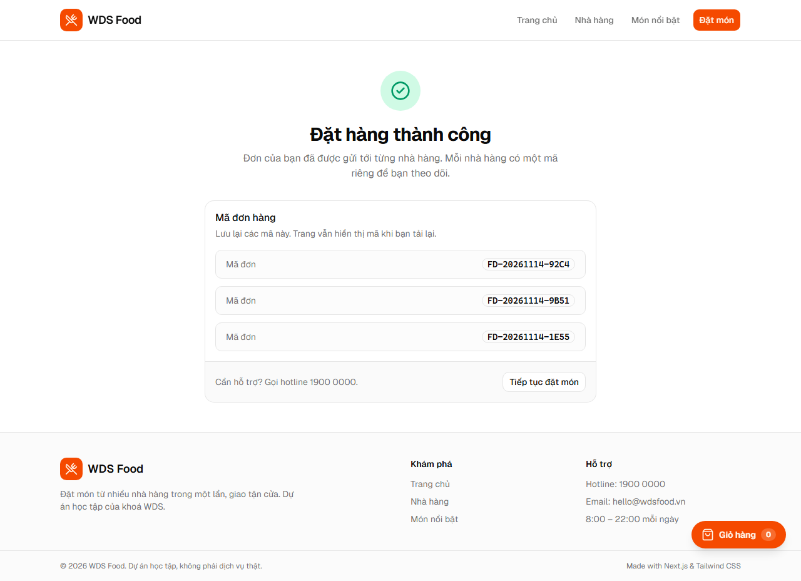
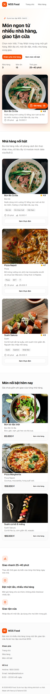

# WDS Food Delivery

Ứng dụng đặt món ăn giao tận nơi, xây dựng trong khoá WDS. Repo là monorepo: frontend Next.js 16 ở `apps/web`, backend ở `apps/api` (sẽ làm ở Buổi 4).

## Tính năng

- Duyệt danh sách nhà hàng và menu kèm ảnh, giá.
- Giỏ hàng **đa nhà hàng**, giữ nguyên khi reload, nhóm món theo nhà hàng.
- Cart Drawer, floating badge và toast phản hồi tức thì.
- Checkout với React Hook Form + Zod, thông báo lỗi tiếng Việt.
- Mock API đặt hàng: tách một đơn cho mỗi nhà hàng, trả mã đơn và xóa giỏ.

## Ảnh chụp màn hình

| Trang chủ | Nhà hàng |
|---|---|
|  |  |

| Giỏ hàng đa nhà hàng | Thanh toán |
|---|---|
|  |  |

| Đặt hàng thành công | Trang chủ trên mobile |
|---|---|
|  |  |

Bộ ảnh được tạo tự động bằng Playwright: chạy `pnpm build`, `pnpm -C apps/web start` ở terminal khác, rồi `pnpm screenshots`.

## Yêu cầu môi trường

- Node.js ≥ 20 (đang dùng 22)
- pnpm 12
- Docker Desktop (cho Postgres)
- Git

## Cài đặt và chạy

```bash
pnpm install
pnpm dev
```

Mở http://localhost:3000.

### Docker

```bash
docker compose up -d
```

Lệnh này bật Postgres 16 tại `localhost:5432` (user/password/database: `wds` / `wds` / `wds_food_delivery`). Database chưa được dùng ở frontend; nó chuẩn bị cho Buổi 4.

## Cấu trúc repo

```
apps/
  web/            Next.js 16 App Router
  api/            Placeholder cho Buổi 4
docs/             PRD, architecture, ADR, tài liệu cho agent, ảnh chụp màn hình
scripts/          check-repo.mjs
```

## Scripts

| Lệnh | Việc |
|---|---|
| `pnpm dev` | Chạy dev server |
| `pnpm build` | Build production |
| `pnpm lint` | Kiểm tra ESLint |
| `pnpm check` | Chạy checker của khoá học |
| `pnpm check:build` | Checker + build |
| `pnpm screenshots` | Chụp lại bộ ảnh trong `docs/screenshots` (cần production server đang chạy) |

## Server và Client Component

Trang chủ và trang nhà hàng là **Server Component**: chúng đọc mock data và render HTML, không cần state trình duyệt. Các phần cần tương tác — nút thêm món, Cart Drawer, floating badge và form checkout — là **Client Component** với `"use client"`, vì chúng dùng Zustand, event handler và LocalStorage. Cách tách này giữ bundle client nhỏ và giúp trang chủ đạt hiệu năng tốt.

## Giỏ hàng

Một giỏ có thể chứa món từ nhiều nhà hàng. Khi đặt hàng, hệ thống tạo **một đơn cho mỗi nhà hàng**, mỗi đơn có mã riêng và phí giao riêng. Lý do và các phương án bị loại được ghi trong [ADR-0001](docs/adr/0001-multi-restaurant-cart.md).

## Đặt hàng (mock API)

`POST /api/orders` là Route Handler giả lập backend, có độ trễ khoảng 400 ms.

- Request: `{ items: { menuItemId, quantity }[], customer: { fullName, phone, address }, note? }`.
- Client chỉ gửi mã món và số lượng; server tra mock data, tự tính giá, phí giao và tổng tiền.
- Server tách đơn theo nhà hàng, trả `201 { orders: [...] }` với mã dạng `FD-YYYYMMDD-XXXX`.
- Dữ liệu sai (món không tồn tại, số lượng ≤ 0, giỏ trống, họ tên/điện thoại/địa chỉ không hợp lệ) trả `400` kèm thông báo tiếng Việt.
- Thành công: chuyển tới `/checkout/success?codes=...` (tải lại trang vẫn giữ mã đơn) và **chỉ xóa giỏ khi API trả 2xx**.

## Kiểm tra bài

```bash
node scripts/check-repo.mjs
node scripts/check-repo.mjs --build
```

Xem hướng dẫn chi tiết trong [README-CHECK.md](README-CHECK.md).

## Tài liệu

- [PRD](docs/PRD.md)
- [Architecture](docs/architecture.md)
- [Glossary](GLOSSARY.md)
- [ADR-0001 — Multi-restaurant cart](docs/adr/0001-multi-restaurant-cart.md)

## Công nghệ

Next.js 16 · React 19 · TypeScript · Tailwind CSS 4 · shadcn/ui · Zustand · React Hook Form · Zod · Sonner · Postgres 16.
