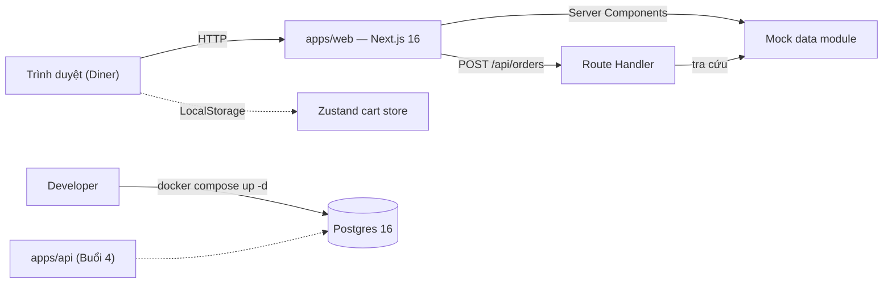
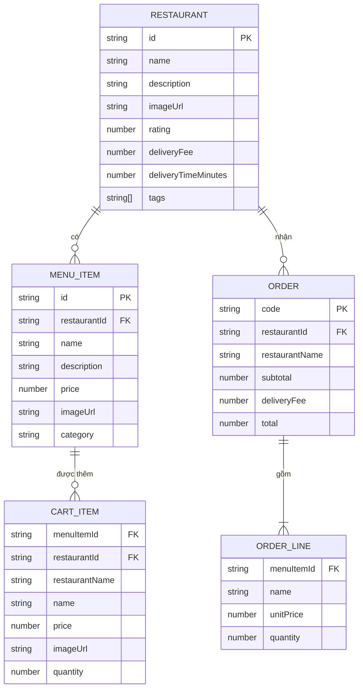
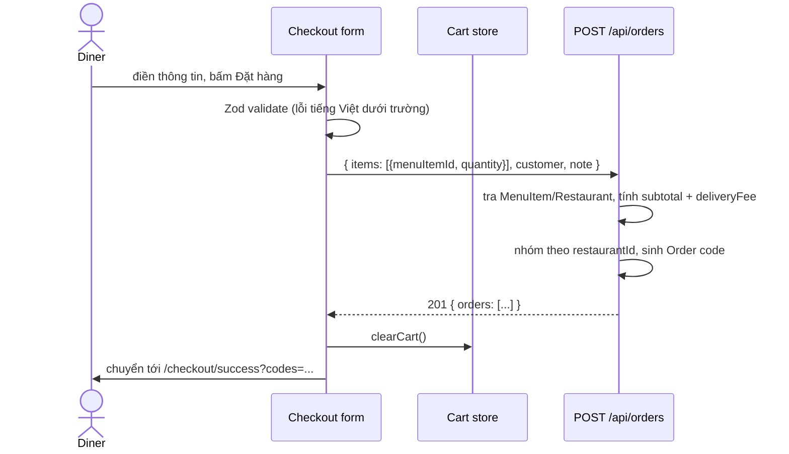

# Architecture — WDS Food Delivery (Frontend)

## 1. Bối cảnh

Monorepo gồm `apps/web` (Next.js 16, App Router) và `apps/api` (placeholder cho Buổi 4). Dữ liệu nhà hàng/món ăn là mock data trong bộ nhớ; đơn hàng được tạo bởi Route Handler và không lưu trữ.



## 2. Route map

```mermaid
flowchart TD
  Layout["app/layout.tsx<br/>Header · Footer · Toaster"] --> Home["/  (Server Component)"]
  Layout --> Restaurant["/restaurant/[id]  (Server Component)"]
  Restaurant --> Loading["loading.tsx"]
  Restaurant --> Error["error.tsx"]
  Restaurant --> NotFound["not-found.tsx"]
  Layout --> Checkout["/checkout"]
  Checkout --> Success["/checkout/success?codes=..."]
  Layout --> Api["POST /api/orders  (Route Handler)"]
  Home -->|chọn nhà hàng| Restaurant
  Restaurant -->|thêm món| Drawer["Cart Drawer (Client)"]
  Drawer -->|Thanh toán| Checkout
  Checkout -->|submit| Api
  Api -->|201 orders[]| Success
```

## 3. Ranh giới Server / Client

| Thành phần | Loại | Lý do |
|---|---|---|
| Trang chủ, trang nhà hàng | Server Component | Đọc mock data, render HTML, không cần state trình duyệt |
| Nút thêm món | Client Component | Gọi action của cart store, hiện toast |
| Cart Drawer, floating badge | Client Component | Đọc store, tương tác, phụ thuộc LocalStorage |
| Form checkout | Client Component | React Hook Form, trạng thái submit |
| Trang xác nhận | Client/Server kết hợp | Đọc `codes` từ query string, hiển thị kết quả |
| `POST /api/orders` | Route Handler | Nhận request, tra mock data, trả JSON |

Nguyên tắc: mặc định Server Component; chỉ thêm `"use client"` ở biên cần tương tác.

## 4. ERD



`CartItem` lưu snapshot để giỏ đã lưu không đổi giá khi mock data thay đổi. API đặt hàng **không** dùng snapshot giá từ client: request chỉ gửi `menuItemId` + `quantity`, server tra lại `MenuItem` và `Restaurant`.

## 5. Luồng đặt hàng



## 6. Quyết định liên quan

- `docs/adr/0001-multi-restaurant-cart.md` — giỏ đa nhà hàng, một Order mỗi Restaurant.
- Spec và ticket: GitHub issue #1 và các sub-issue.
